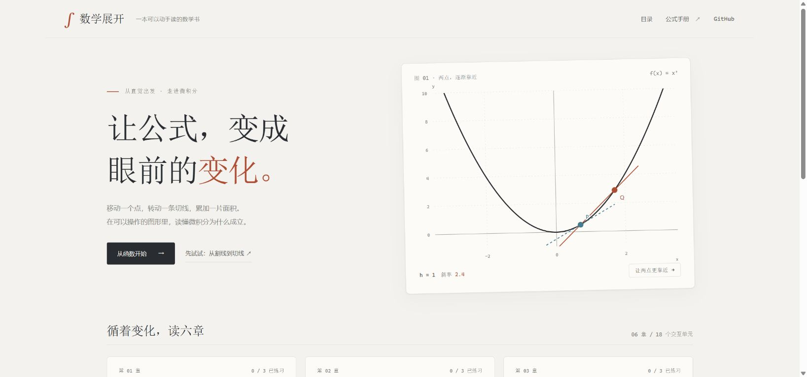

# 数学展开

在线体验：[math.selfworks.ai](https://math.selfworks.ai/)

新增试点：[斜率，究竟在说什么？](https://math.selfworks.ai/slope.html)。先听约 77 秒中文讲解、看同步动画，再预测、操作和检验理解；面向初中学习者，截距固定为 0。

**让公式，变成眼前的变化。**

一个中文交互式微积分学习网站。通过滑块、可以拖动的观察点、割线、切线和面积图形，把直观观察与数学公式连接起来。

第一版包含 **6 章、18 个交互单元、18 道练习及解析**。这是独立项目，与物理网站的代码仓库和部署分开维护，正式站已部署在 `math.selfworks.ai`。



## 内容

| 章节 | 三个单元 |
| --- | --- |
| 函数与图像 | 斜率与截距、抛物线变换、正弦的振幅与周期 |
| 极限 | 可去间断点、不同的单侧极限、无穷远处的极限 |
| 导数 | 从割线到切线、瞬时变化率、链式法则 |
| 导数的应用 | 增减与极值、固定周长的面积最优化、牛顿迭代 |
| 积分 | 黎曼和、有向面积、由速度累加位移 |
| 微积分基本定理 | 面积函数、面积函数的导数、原函数与端点之差 |

每单元包含中文讲解、公式、操作提示、实时图形和数值、一道使用独立参数的练习。可切换辅助线或面积图层，播放参数变化，重置图形，并打开随时可查的公式手册。

讲解和题目为本项目编写，未复制物理教材内容、官方考试题或官方公式表。它面向已接触坐标系、基础代数及弧度的学习者，是可视化入门材料，不替代完整课程中的证明与练习。

## 本地运行

需要 Node.js 22 或更新版本。**运行和测试都不需要安装第三方依赖。**

```powershell
git clone https://github.com/Kayce001/math-unfolded.git
cd math-unfolded
npm start
```

打开 <http://127.0.0.1:8140/>。退出服务器使用 `Ctrl+C`。

也可以用任意静态 HTTP 服务器托管 `public/`。不要直接双击 HTML：浏览器模块需要 HTTP 环境。

```powershell
python -m http.server 8140 --directory public
```

## 操作

- 拖动滑块或图中的可拖动观察点，曲线、读数和说明会同步变化。
- 滑块或观察点获得焦点时，用方向键微调；页面正文获得焦点时，用 `←`、`→` 翻到相邻单元。
- “播放变化”是主动播放，默认不会自动播放；切换单元、进入公式手册或离开页面会停止播放。
- 完成练习后查看解析，也可以重新作答。练习使用题干中的固定参数，与图形当前设置独立。
- 本机练习记录保存在浏览器 localStorage；没有账号、服务器端学习记录或数据上传。
- 单元可以通过 hash 链接定位，例如 `/#/derivatives/secant`；复制地址即可分享。

## 检查

```powershell
npm run check
```

包含 JavaScript 语法检查与 Node 内置测试。数学检查覆盖差商极限、未定义点、链式法则、黎曼和收敛、有向面积、牛顿迭代、约束最优化、微积分基本定理及滑块边界。

## 结构

```text
public/
  index.html    页面入口与公式手册容器
  app.js        路由、参数、练习、播放、拖动与键盘交互
  content.js    六章讲解、题目与公式手册
  math.js       可独立测试的数学计算和图形模型
  graph.js      SVG 坐标系、曲线、面积、辅助线与观察点
  style.css     桌面书页和手机排版
  icon.svg      本地站点图标
tools/serve.mjs 本地服务器，仅公开 public/
tests/          纯数学与内容完整性检查
```


## 许可

代码、讲解、练习和程序生成的图形以 [MIT 许可证](LICENSE) 提供。Copyright © 2026 Kayce001。
